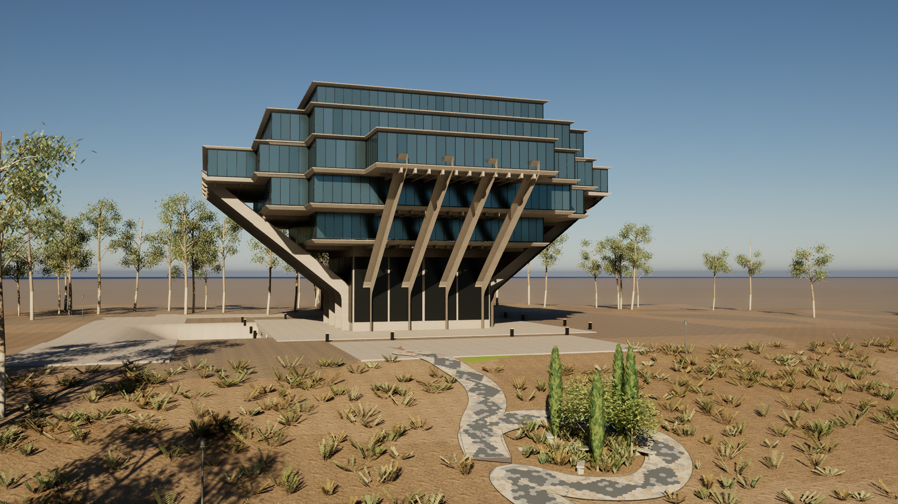
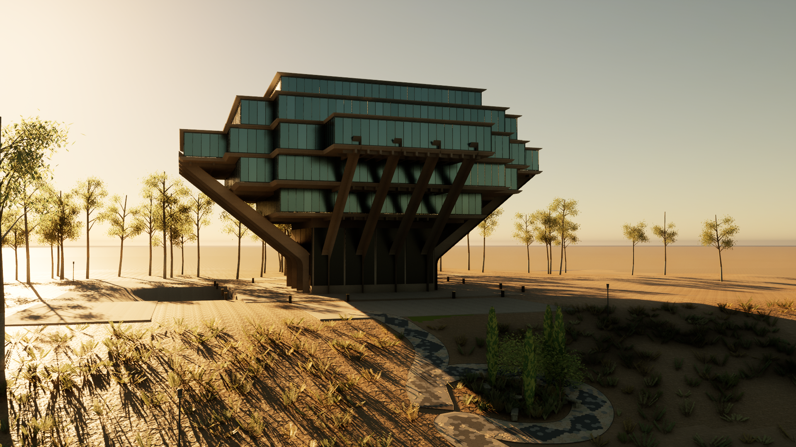
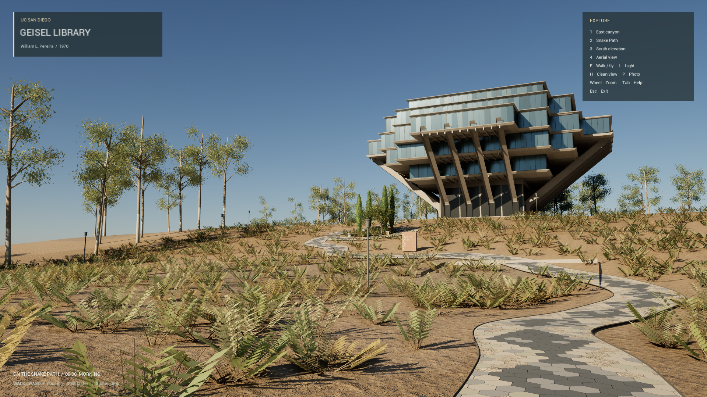

# Geisel Library · Snake Path

UC San Diego 标志性建筑与东侧蛇路的可编辑三维场景。正确名称为 **Geisel Library**，项目位于 `D:\Projects\GeiselLibrary`。

An editable exterior reconstruction of UC San Diego's Geisel Library and Alexis Smith's Snake Path, with a Blender source scene and an interactive Unreal Engine 5.7 experience. Independent project; see the fidelity limits and asset notices below.



| 金色傍晚 | 在蛇路上步行 |
| --- | --- |
|  |  |

以上是项目的实际 Unreal 运行截图。更多视角及蓝调时段见 [Previews](Previews/)。

## 开始体验

双击项目根目录的 `Launch_GeiselLibrary.cmd`，启动 Unreal 实时场景。第一次启动可能需要编译材质，请等画面稳定。点击画面后即可用鼠标与键盘探索。

双击 `Open_GeiselLibrary_Blender.cmd` 可以打开完整的可编辑 Blender 场景。Unreal 工程为 `UnrealProject/GeiselExplorer.uproject`。

### 从 GitHub 首次获取

仓库包含主模型、FBX / GLB、Unreal 关卡和全部可编辑源码，大型模型及 Unreal 资源使用 **Git LFS**。安装 [Git LFS](https://git-lfs.com/) 后获取完整资源：

```powershell
git lfs install
git clone https://github.com/JunjieNian/GeiselLibrary.git
cd GeiselLibrary
git lfs pull
```

也可以从 [Releases](https://github.com/JunjieNian/GeiselLibrary/releases/latest) 下载 `GeiselLibrary-v1.0.0-source.zip`，其中包含完整大模型文件，解压后无需 Git LFS。GitHub 自动生成的 “Source code (zip)” 可能得到 LFS 指针，请选择带项目名字的附件或使用上述克隆方式。只需要修改模型时，用 **Blender 4.5 LTS** 打开 `SourceAssets/GeiselLibrary.blend` 即可。

实时游览需要 **Windows 64 位、Unreal Engine 5.7**，首次编译还需要 **Visual Studio 2022 的 C++ 游戏开发工具和 Windows SDK**。仓库提供已导入的关卡，但不包含 Unreal 引擎或本机编译产物。在项目根目录的 PowerShell 中运行以下命令，把引擎目录替换成自己的安装路径：

```powershell
$env:GEISEL_UNREAL_ROOT = 'D:\EpicGames\UE_5.7'
& .\Tools\Unreal\build_and_setup.ps1 -UnrealRoot $env:GEISEL_UNREAL_ROOT -SkipSceneImport
& .\Launch_GeiselLibrary.cmd
```

`-SkipSceneImport` 只编译游览程序，使用仓库已保存的关卡。双击启动器时，可设置 `GEISEL_UNREAL_ROOT` 环境变量；启动器也识别本机的 D 盘路径和常见的 Program Files 安装位置。Blender 启动器可通过 `GEISEL_BLENDER_EXE` 指定 `blender.exe`。Lumen 和虚拟阴影需要现代独立显卡；已在 RTX 4070 Laptop 上验证，尚未覆盖其他硬件。

| 操作 | 功能 |
| --- | --- |
| 鼠标 | 环顾 |
| W / A / S / D | 前后左右移动 |
| Shift | 加速 |
| Q / E | 飞行时下降 / 上升 |
| F | 步行 / 飞行切换；进入步行会落到蛇路起点 |
| 1 / 2 / 3 / 4 | 切换四个预设观景视角 |
| L | 切换上午、金色傍晚与蓝调时段 |
| 滚轮 | 改变视角焦距 |
| H | 隐藏 / 显示界面 |
| Tab | 展开 / 收起操作帮助 |
| P | 保存截图 |
| 空格 | 步行时跳跃 |
| Esc | 退出 |

截图默认保存在 `UnrealProject/Saved/Screenshots/Geisel/`。飞行可用于观察建筑上部和整体地形；步行用于体验蛇路与坡地空间。

## 场景内容

- 第六层最宽的五层悬挑阅读塔、按固定结构网格逐层退台的轮廓、16 根外展混凝土支柱、檐下肋梁、反光玻璃及细金属窗框。
- 建筑东侧从高处 forum 通往较低 Warren Mall 的蛇路，狭长六边形石板鳞片、连续深色斑纹、蛇头及蛇舌。
- 环形 Eden 花园、柱状常绿树、果树、低灌木、石凳与《失乐园》花岗岩石书。
- 干土与本地灌木为主的坡地、桉树林背景、局部校园铺装与草坪。
- Unreal 的动态太阳、天空、全局光照、反射、阴影及可切换的光照预设。

## 可编辑文件

| 路径 | 用途 |
| --- | --- |
| `SourceAssets/GeiselLibrary.blend` | 主场景；保留各类几何、材质、相机、灯光 |
| `SourceAssets/GeiselSite.fbx` | 导入 Unreal 的场景几何 |
| `SourceAssets/GeiselSite.glb` | 通用三维格式，便于在其他工具中继续使用 |
| `SourceAssets/scene_manifest.json` | 尺度、材质、镜头与景观元数据 |
| `Tools/Blender/build_scene.py` | 建筑、灯光、相机与导出生成器 |
| `Tools/Blender/landscape.py` | 地形、蛇路、石书、树木与植物生成器 |
| `UnrealProject/Content/Geisel/` | 已导入的网格、材质和可打开的关卡 |
| `UnrealProject/Source/GeiselExplorer/` | 可编辑的移动、交互、视角、光照和界面逻辑 |
| `Docs/ReferenceStudy.md` | 参考来源、已核实事实与估计部分 |
| `Docs/Lighting.md` | 太阳位置计算、时间与光照说明 |
| `Previews/` | 场景渲染与运行截图 |

坐标约定：Blender 使用米，X 向东、Y 向北、Z 向上；Unreal 使用厘米，Y 轴符号反转。生成脚本固定随机种子，便于复现和继续修改。

## 复原依据与精度

建筑比例依据 UCSD 图书馆官方介绍、原始建筑立面/平面参考和实景照片；Snake Path 依据 Stuart Collection 官方资料和原始设计图。建筑高度参考官方 110 ft（33.528 m）；塔楼最宽第六层按原始报告采用约 200 ft（60.96 m），第五与第七层约 150 ft（45.72 m）。官网 248 ft（75.5904 m）最大跨度的口径与楼板不同，没有把它直接作为塔楼宽度。蛇路参考长度 560 ft（170.688 m）、宽度 10 ft（3.048 m）。

这是依据公开资料制作的**外观与环境重建**。没有使用现场激光扫描、摄影测量、完整施工图或校准后的现场光照数据，因此逐根构件尺寸、地形高程、种植位置和部分铺装是视觉估计；地下扩建、室内藏书空间及周边完整校园没有做逐项精确复原。太阳方向使用地理位置与日期计算，天气和曝光保留美术调节。

`References/` 中的照片与原图仅用于本地建模对照，权利归原作者，**没有上传到公开仓库**；仓库保留来源与署名说明。场景几何、程序化材质和植物由本项目生成；混凝土及干土使用 Poly Haven 的 CC0 扫描表面贴图（`SourceAssets/Textures/provenance.json`）。参考建筑照片没有充当场景贴图。来源及许可见 [References/README.md](References/README.md) 和 [THIRD_PARTY_NOTICES.md](THIRD_PARTY_NOTICES.md)。本项目未指定整体开源许可证，公开访问不等于授予全部文件的再分发许可。

## 重新生成

1. 运行 `Tools/Blender/rebuild_scene.ps1`，生成 Blender、FBX、GLB、元数据与静态预览。
2. 运行 `Tools/Unreal/build_and_setup.ps1`，编译交互程序并重新导入关卡。
3. 运行 `Tools/Unreal/run_selftest.ps1`，检查移动、落地、镜头与光照切换，并生成实际运行截图。

Blender 重建脚本可用 `-BlenderExe '自己的 blender.exe 路径'`；Unreal 脚本可用 `-UnrealRoot '自己的 UE_5.7 目录'`。修改几何后应重新导入，运行 `build_and_setup.ps1` 时省略 `-SkipSceneImport`。

验证结果与已知边界见 [Docs/Validation.md](Docs/Validation.md)，模型检查见 [Docs/GeometryValidation.json](Docs/GeometryValidation.json)，最终导入与运行断言见 [Docs/RuntimeValidation.json](Docs/RuntimeValidation.json)。
