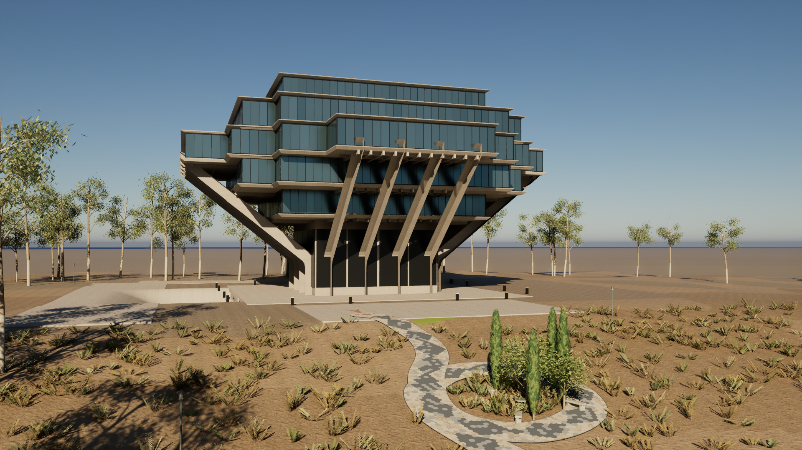
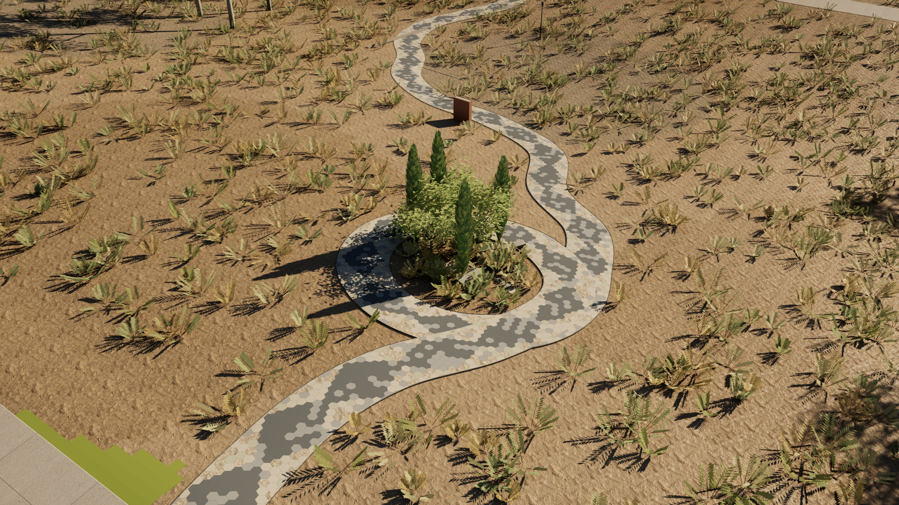
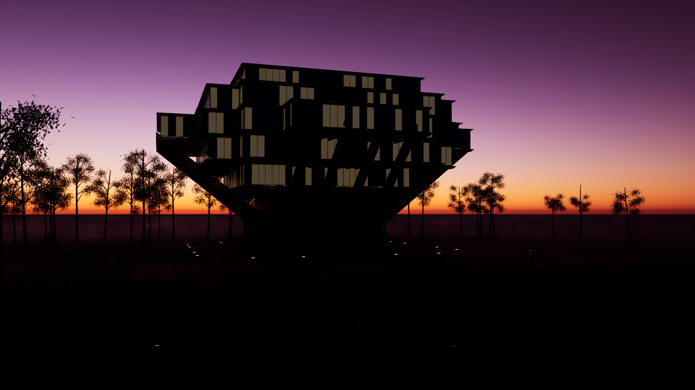

# Geisel Library · Snake Path

An open-source, editable 3D reconstruction of UC San Diego's Geisel Library and Alexis Smith's Snake Path. Explore the hillside in Unreal Engine, study the architecture in Blender, or adapt the scene using the procedural generators and exported models.



Snake Path forms a continuous slate-paved coil around the planted Garden of Eden, then winds down the hillside past the *Paradise Lost* stone book.



All images above are captures from the interactive Unreal Engine experience.

| Golden hour | Blue hour |
| --- | --- |
|  |  |

## Features

- Five cantilevered tower floors, with the sixth floor widest, stepped floor outlines, sixteen inclined concrete piers, underside ribs, reflective glazing, and window frames.
- A continuous Snake Path with elongated hexagonal slate scales, patterned markings, an inlaid head and forked tongue, and a complete garden coil.
- A planted Garden of Eden, stone benches, a bird bath, and the upright *Paradise Lost* granite book.
- A sloping coastal landscape with eucalyptus groves, shrubs, campus paving, and lawns.
- First-person walking and flight, preset viewpoints, adjustable field of view, photo controls, and three lighting presets.
- Editable Blender and Unreal projects, FBX and GLB exports, deterministic generation scripts, and geometry and runtime validation.

## Get the project

Install [Git LFS](https://git-lfs.com/) before cloning. The Blender scene, exported models, and Unreal assets are stored with LFS.

```powershell
git lfs install
git clone https://github.com/JunjieNian/GeiselLibrary.git
cd GeiselLibrary
git lfs pull
```

Use a clone with Git LFS to obtain the current scene and its complete assets. GitHub's automatically generated source archives may contain LFS pointers instead of the model files.

## Explore in Unreal Engine

Requirements:

- Windows 64-bit and **Unreal Engine 5.7**.
- Visual Studio 2022 with C++ game development tools and a Windows SDK for the initial build.
- A modern dedicated GPU for Lumen and virtual shadow maps. Runtime validation has been performed on an RTX 4070 Laptop GPU; performance on other hardware may vary.

From the repository root, replace the engine placeholder with your Unreal Engine installation directory:

```powershell
$env:GEISEL_UNREAL_ROOT = '<path-to-UE_5.7>'
& .\Tools\Unreal\build_and_setup.ps1 -UnrealRoot $env:GEISEL_UNREAL_ROOT -SkipSceneImport
& .\Launch_GeiselLibrary.cmd
```

`-SkipSceneImport` builds the C++ experience and uses the saved scene included in the repository. Allow the initial shader compilation to finish, then click the viewport to explore.

The launchers use `GEISEL_UNREAL_ROOT` when set. To install the themed Windows desktop shortcut after the build:

```powershell
& .\Tools\Windows\Install_DesktopShortcut.ps1 -UnrealRoot $env:GEISEL_UNREAL_ROOT
```

The icon, original artwork, and generation record are in [Assets/Branding](Assets/Branding/).

### Controls

| Input | Action |
| --- | --- |
| Mouse | Look around |
| W / A / S / D | Move |
| Shift | Move faster |
| Q / E | Descend / ascend in flight |
| F | Switch between walking and flight; walking starts at the Snake Path approach |
| 1 / 2 / 3 / 4 | Select a preset viewpoint |
| L | Cycle morning, golden-hour, and blue-hour lighting |
| Mouse wheel | Adjust field of view |
| H | Show / hide the interface |
| Tab | Show / hide control help |
| P | Save a screenshot |
| Space | Jump while walking |
| Esc | Exit |

Screenshots are saved to `UnrealProject/Saved/Screenshots/Geisel/`.

## Edit in Blender

Open `SourceAssets/GeiselLibrary.blend` in **Blender 4.5 LTS**. The scene retains separate geometry groups, materials, cameras, and lighting. `SourceAssets/GeiselSite.fbx` and `SourceAssets/GeiselSite.glb` provide interchange formats for other tools.

The optional Blender launcher accepts `GEISEL_BLENDER_EXE`:

```powershell
$env:GEISEL_BLENDER_EXE = '<path-to-blender.exe>'
& .\Open_GeiselLibrary_Blender.cmd
```

## Rebuild the scene

Run these steps after modifying the generators:

```powershell
& .\Tools\Blender\rebuild_scene.ps1 -BlenderExe $env:GEISEL_BLENDER_EXE
& .\Tools\Unreal\build_and_setup.ps1 -UnrealRoot $env:GEISEL_UNREAL_ROOT
& .\Tools\Unreal\run_selftest.ps1 -UnrealRoot $env:GEISEL_UNREAL_ROOT
```

The Blender step regenerates the editable scene, FBX, GLB, metadata, and validation reports. It prepares **Shapely 2.1.2** in the ignored `.cache/blender-python/` directory to merge the Snake Path coil and clip overlapping slate surfaces. Blender render previews are stored in `.cache/previews/`; the interactive experience does not require these modeling dependencies.

The Unreal step imports the regenerated geometry and saves the level. The self-test checks movement, grounding, viewpoints, lighting, and 62 collision probes around the garden coil, then refreshes the curated runtime images in `Previews/`.

## Repository layout

| Path | Contents |
| --- | --- |
| `SourceAssets/` | Editable Blender scene, FBX / GLB exports, scene metadata, and surface textures |
| `UnrealProject/` | Unreal level, imported assets, configuration, and interaction source |
| `Tools/Blender/` | Architecture, landscape, export, and geometry validation scripts |
| `Tools/Unreal/` | Build, import, and runtime validation tools |
| `Tools/Windows/` | Icon packaging and desktop shortcut installer |
| `Assets/Branding/` | Project icon and artwork provenance |
| `Previews/` | Curated screenshots of the current interactive scene |
| `Docs/` | Reference study, lighting notes, and validation records |
| `References/README.md` | Reference links, credits, and image provenance |

The model uses meters with X east, Y north, and Z up. Unreal uses centimeters with the Y axis reversed. The generators use fixed random seeds for reproducible edits.

## References and fidelity

The architecture is guided by UC San Diego's building information, the original Pereira report, architectural drawings, and photographs. The Snake Path reconstruction uses Stuart Collection documentation and its original plan.

The library height reference is 110 ft (33.528 m). The widest tower floor follows the original report's approximately 200 ft (60.96 m) span; the fifth and seventh floors follow approximately 150 ft (45.72 m). The separately reported 248 ft overall span uses a different measurement scope. Snake Path's documented dimensions are 560 ft long by 10 ft wide (170.688 m × 3.048 m).

This is a reference-guided exterior reconstruction. Individual dimensions, terrain grades, planting, and surrounding paving are visual estimates rather than survey data. The underground expansion, library interiors, and the full campus are outside the modeled scope. Lighting presets use a geographic solar calculation, with artistic choices for weather and exposure.

See [ReferenceStudy](Docs/ReferenceStudy.md), [Lighting](Docs/Lighting.md), and [Validation](Docs/Validation.md). Machine-readable checks are available in [GeometryValidation](Docs/GeometryValidation.json), [SnakePathValidation](Docs/SnakePathValidation.json), and [RuntimeValidation](Docs/RuntimeValidation.json).

## Contributing

Issues and pull requests are welcome. Include reference links for architectural or landscape changes. When changing generated geometry, update the editable model, exports, Unreal scene, and relevant validation records together. Keep reference photographs, caches, logs, and build outputs out of version control.

## License and attribution

Original project code and project-authored scene assets are released under the [MIT License](LICENSE). Poly Haven surface textures retain their [CC0](https://creativecommons.org/publicdomain/zero/1.0/) terms. See [THIRD_PARTY_NOTICES](THIRD_PARTY_NOTICES.md) for attribution and third-party rights.

Reference photographs and drawings are credited through links and are not included as scene textures or repository assets. The depicted architecture and Alexis Smith's artwork retain their respective rights. Unreal Engine and Blender are separate software requirements. This independent project is not affiliated with or endorsed by UC San Diego.
